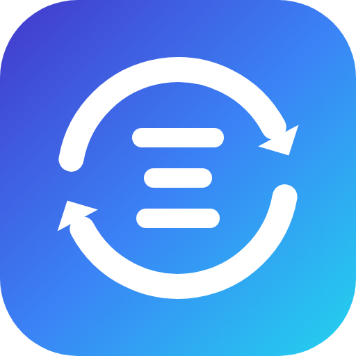

<p align="center"></p>

<h1 align="center">model-meta-sync</h1>

<p align="center">A native <a href="https://github.com/router-for-me/CLIProxyAPI">CLIProxyAPI</a> (CPA)
plugin that fills the model metadata CPA stores per provider entry
(<code>api-keys.openai-compatibility[].models[]</code>) from each gateway's own OpenAI-compatible
<code>GET /v1/models</code> response, so <code>display-name</code>, <code>max-context-length</code>,
<code>input-modalities</code>, <code>output-modalities</code> and <code>thinking.levels</code> no
longer have to be typed by hand.</p>

<p align="center">
  <a href="https://github.com/LIEGU0317/cpa-plugin-model-meta-sync/releases/latest"></a>
  
  
  <a href="LICENSE"></a>
</p>

- Host: **CPA v8** (plugin ABI 1 / schema 8), Go `c-shared` plugin (`CGO`).
- Scope: **every enabled `openai-compatibility` provider** in the config. No vendor, host or address
  is hard-coded and no allow-list is required; `providers:` only narrows the set when you want to.
- Matching: provider entries are selected **by provider name**. Models are matched **by model name**
  (exact -> case -> bare name -> separator-free spelling -> catalog suffixes), so a gateway's naming
  style does not have to be declared anywhere.
- Packaging: plugin-store layout - `<id>_<version>_<goos>_<goarch>.zip` with the library at the zip
  root plus `checksums.txt` (see [Releases](#releases)).
- Current release: **0.4.0**.

## Why a plugin

CPA never queries an openai-compatibility provider's `/v1/models`; the provider model list only
exists in `config.yaml`. This plugin fills that gap: it fetches each gateway's catalog, maps the
fields CPA understands, merges them into the provider entries, validates the change and lets CPA's
file watcher hot-reload the config. Models are never added or removed.

## What gets synced

| Upstream (OpenAI-compatible) | CPA provider model key | Rule |
|---|---|---|
| `id` | `name` | exact match first, then the relaxed name spellings below |
| `display_name` (fallback `display-name`, then `name`) | `display-name` | fill if empty; overwrite only when opted in |
| `context_length` (`context_window`, `max_input_tokens` fallbacks) | `max-context-length` | fill if `0`; overwrite only when opted in. `max_output_tokens` is an **output** limit, not context |
| `modalities.input` | `input-modalities` | skipped when the upstream omits it (never guessed) |
| `modalities.output` | `output-modalities` | same |
| `reasoning_levels` / `supported_reasoning_levels[].effort` / `reasoning_supported_efforts` | `thinking.levels` | requires `reasoning` / `supports_reasoning` / `only_reasoning`; level names are filtered to CPA's vocabulary |

Gateways such as workbuddy2api publish the human label as `name` and only `modalities.input`; that is
handled, and a label identical to the id is ignored. A single `reasoning_effort` value is **not**
turned into a thinking ladder - that would narrow the levels CPA offers.

Not representable in CPA config: `max_output_tokens` (no field), `native_endpoints`, `pricing`,
`service_tiers`, `supported_parameters`.

## Name matching

A configured model name is resolved against the provider's own upstream list, in this order:

1. exact `name` / `alias`, then case-insensitive;
2. the bare name (everything after the last `/`);
3. a separator-free spelling (`DeepSeek-V4.1-Flash`, `deepseek-v41-flash` and `deepseek v4.1 flash`
   all fold to `deepseekv41flash`);
4. the same spelling plus a catalog decoration suffix (`-exp`, `-experimental`, `-latest`,
   `-preview`, `-free`);
5. the configured name with a trailing deployment qualifier stripped (`-self`, `-official`), and only
   after every other spelling failed.

Every relaxation is refused when two different upstream ids collapse to the same key - the plugin
prefers no metadata over the wrong metadata. One-way suffixes are intentional: `gpt-4o-free` is a
different endpoint from `gpt-4o`.

## Behavior contract

- `mode: missing` (default) fills empty fields only. `overwrite_fields` opts specific fields into
  authoritative overwrite; `mode: always` recomputes every listed field. An absent
  `overwrite_fields` means "never overwrite" - it does not inherit the empty-list-means-all rule.
- One unreachable gateway does not block the others: failures are reported per provider and that
  provider's entries stay untouched. Only when every selected upstream fails is nothing written.
- Disabled providers are skipped unless `include_disabled: true`.
- Provider identity is the configured **name** only. Reports, logs and error messages never echo
  `base-url`, hosts, IPs or ports.
- Never adds/removes models and never edits `name`, `alias`, `base-url`, keys or other providers.
- Safety: timestamped backup, provider-scoped semantic-diff validation, sha256 conflict detection
  before writing, staged copy for recovery, in-place write so CPA's inode watcher fires the hot reload.
- YAML anchors/aliases around a provider's model list skip **that provider** (reported in
  `warnings[]`) instead of leaking writes across providers.
- Multi-document YAML configs are rejected, never rewritten.

## Install

### From the plugin store

The repository publishes the artifacts and metadata the store expects
([`store/registry-entry.json`](store/registry-entry.json), [`store/README.md`](store/README.md)).
Once the entry is in `CLIProxyAPI-Plugins-Store`, install it from the management UI or directly:

```bash
curl -X POST -H "X-Management-Key: $CPA_KEY" \
  http://127.0.0.1:8317/v8/management/plugins/store/model-meta-sync/install
```

The store resolves the repository's latest release for the host platform, verifies `checksums.txt`
and unpacks `model-meta-sync.<ext>` into `plugins/<goos>/<goarch>/model-meta-sync-v<version>.<ext>`.

### From a release archive

Each platform archive holds exactly one dynamic library at its root (`model-meta-sync.so`,
`model-meta-sync.dylib` or `model-meta-sync.dll`) - the only layout the host installer accepts:

```bash
VERSION=0.3.1
curl -LO https://github.com/LIEGU0317/cpa-plugin-model-meta-sync/releases/download/v$VERSION/model-meta-sync_${VERSION}_linux_amd64.zip
curl -LO https://github.com/LIEGU0317/cpa-plugin-model-meta-sync/releases/download/v$VERSION/checksums.txt
sha256sum -c --ignore-missing checksums.txt
unzip -o model-meta-sync_${VERSION}_linux_amd64.zip -d <cpa>/plugins/linux/amd64/
```

A convenience build is also tracked in the repository:

```text
plugins/linux/amd64/model-meta-sync-v0.3.1.so
plugins/linux/amd64/model-meta-sync-v0.3.1.so.sha256   # 5e29f03ddfc273e54cb4e9ee38f689ac15364a21a96a89259a6e39aaf3f044b3
```

It is the exact library from `model-meta-sync_0.3.1_linux_amd64.zip` in the `v0.3.1` release (unzip it
and you get the same sha256), built from this source with `-trimpath`, `CGO_ENABLED=1`, Go 1.26.10 and
the CPA v8.0.47 SDK - which is what `go version -m` on the artifact reports.

### From source

Building needs Go >= 1.26 plus a C toolchain for the target arch. `make build` writes the plugin and
its `.sha256` into `plugins/<goos>/<goarch>/`, `make dist` additionally writes the store-shaped zip
into `dist/`:

```bash
make build GOOS=linux GOARCH=amd64
# -> plugins/linux/amd64/model-meta-sync-v0.3.1.so (+ .sha256)
make dist GOOS=linux GOARCH=amd64
# -> dist/model-meta-sync_0.3.1_linux_amd64.zip
```

### Configure

Add the config block to `config.yaml` and restart CPA once (the plugin host scans the plugin
directory at startup):

```yaml
plugins:
    configs:
        model-meta-sync:
            enabled: true
            # config_path: /path/to/config.yaml          # optional; omitted = host -config / ./config.yaml
            mode: missing                               # missing | always
            fields: [display-name, max-context-length, input-modalities, output-modalities, thinking]
            # providers: [Gateway A]                    # optional filter; omit to sync every provider
            # include_disabled: false
            # models_paths:                            # only for non-standard catalogs
            #     Spark: /models                       #   e.g. base-url .../v2 -> .../v2/models
            timeout_seconds: 20
            backup_keep: 10
            sync_on_start: true                         # default true: enrich in the same reload
            dry_run_on_start: false                     # true = startup run only reports
            interval_minutes: 0                         # >0 repeats the sync on a timer
            # api_keys:                                # optional per-provider key override;
            #     Gateway A: sk-...                    #   omitted = the provider's first key
```

A key override is never sent to any provider other than the one it is keyed by. The older single
`api_key` is only accepted together with `providers: [<one name>]`; a config with an unscoped
`api_key` is rejected instead of sending that key to every gateway.

`config_path` is optional. The plugin resolves the CPA config from the host process: its `-config`
flag when present, otherwise `config.yaml` in the process working directory - the same fallback CPA
itself uses. It needs the path only because it writes the file directly (the host ABI exposes no
config read/write), which is also why other plugins never ask for it.

### Non-standard catalogs

Model discovery mirrors CPA's own "fetch from endpoint": the plugin tries `/v1/models` and then
`/models` on the provider's `base-url`, retrying the second only on 404/405. That covers gateways
rooted below `/v1` (讯飞星火 serves `/v2/models`). A provider whose catalog lives somewhere else gets
an explicit entry:

```yaml
models_paths:
    Spark: /models
    Some Gateway: /custom/catalog
```

Paths are appended to `base-url` the same way (`/v1` duplication is avoided).

### Binding to "fetch from endpoint"

Applying models in the CPAMC provider editor writes `config.yaml`, CPA hot-reloads it and
re-registers the plugin, which runs its startup sync. With `sync_on_start: true` (the default) the
newly applied models therefore get their metadata in the same operation — no second click. Verified
in the sandbox: a model added to a running CPA was enriched within one reload cycle.

Details and rollback: [`runbook/deploy.md`](runbook/deploy.md).

## Management API

Requires the normal CPA management key (`X-Management-Key` or `Authorization: Bearer ...`).

| Method | Path | Purpose |
|---|---|---|
| GET | `/v0/management/model-meta-sync/status` | last run report + effective config |
| GET | `/v0/management/model-meta-sync/config` | effective config + redacted raw plugin config |
| GET | `/v0/management/model-meta-sync/preview` | dry run: compute the patch, write nothing |
| POST | `/v0/management/model-meta-sync/sync` | fetch upstream `/v1/models` and write; `?dry_run=1`, `?provider=Name` |

Every upstream failing -> HTTP 502, `ok:false`, file untouched. Unknown provider name -> 400.
Reports identify providers by name only - no `base_url` field exists.

## Plugin metadata

The plugin registers the descriptor the management UI and the plugin store read
(`sdk/pluginapi.Metadata`):

| Field | Value |
|---|---|
| `Name` | `model-meta-sync` - the plugin id and the `plugins.configs.<id>` key |
| `Version` | stamped from the release tag at build time (`-X main.pluginVersion=...`) |
| `Author` | `LIEGU0317` |
| `GitHubRepository` | this repository |
| `Logo` | [`assets/logo.png`](assets/logo.png), served from `main` |
| `ConfigFields` | every `plugins.configs.model-meta-sync` key with type, default, enum values and description |

`Logo` is the card image in the store and the management plugin list; `ConfigFields` is what the
plugin's configuration form is generated from, so the plugin ships no UI of its own.
`plugin/metadata_test.go` enforces both: it fails when a parsed config key is not advertised (or an
advertised key is not parsed), when a field has no description, and when an advertised default drifts
from the value `parseConfig` applies.

Icon sources live in [`assets/`](assets): `icon.svg` is the master, `logo.png` (512), `logo-128.png`
and `logo-32.png` are rendered from it - `scripts/render-icon.sh` regenerates them.

## Releases

Release tags are `v<version>` with a dotted numeric version, and the tag is the only source of the
published version. Each release carries one archive per platform plus `checksums.txt`:

```text
model-meta-sync_0.3.1_linux_amd64.zip
model-meta-sync_0.3.1_linux_arm64.zip
model-meta-sync_0.3.1_darwin_amd64.zip
model-meta-sync_0.3.1_darwin_arm64.zip
model-meta-sync_0.3.1_windows_amd64.zip
checksums.txt
```

`.github/workflows/build.yml` builds every platform with CGO, packages with
`plugin/cmd/zipdist` (which re-verifies the archive layout the host installer accepts) and publishes
the assets. A `smoke` job then loads each archive in a **real CLIProxyAPI binary for that platform**
(`scripts/smoke-test.sh`): it asserts the registered metadata, syncs a mock upstream, checks the
config was enriched and hot-reloaded, and that a second run writes nothing.

| Platform | Built | Loaded by a real host |
|---|---|---|
| linux/amd64 | CI, native x86-64 | **yes** - registration, sync, hot reload, idempotent |
| linux/arm64 | CI, native arm64 | **yes** - same checks |
| windows/amd64 | CI, native x86-64 | **yes** - same checks |
| darwin/arm64 | CI, native Apple silicon | **yes** - same checks |
| darwin/amd64 | CI, native Intel | **no** - the host itself fails on macOS Intel (see below) |

`darwin/amd64` is published because the store installs per platform, but macOS **Intel** hosts cannot
load Go `c-shared` plugins at all in CLIProxyAPI v8.0.53: the same run fails for the official
`antigravity-priority` plugin (`preflight probe failed ... fatal error: addspecial on invalid pointer`)
and for this one (`runtime: unexpected return pc for runtime.cgocallback`), i.e. two Go runtimes in one
process. Apple-silicon macOS, Linux and Windows are unaffected. The smoke entry for darwin/amd64 is
therefore informational and never blocks a release.

Locally:

```bash
make build      # plugins/<goos>/<goarch>/model-meta-sync-v<version>.so (+ .sha256)
make dist       # + dist/model-meta-sync_<version>_<goos>_<goarch>.zip
make checksums  # dist/checksums.txt over every zip present
make release    # dist + checksums + layout verification for the host arch
make verify-dist
```

`make version-check` (also run by `make test` and by CI) refuses a build where `VERSION` and the
`pluginVersion` default in `plugin/main.go` disagree, so an artifact cannot advertise a version its
release tag does not match.

## Build, test, deploy

```bash
make build            # plugin .so for the host arch
make test             # version check + go test ./...
make fmt vet
```

The sandbox integration suite (mock upstream + real CPA binary) lives in the development workspace and
is not part of this repository; results are archived under [`evidence/`](evidence/).

## Evidence

- [`recon/models-diff.md`](recon/models-diff.md) - field-level upstream vs CPA comparison.
- [`recon/plugin-landscape.md`](recon/plugin-landscape.md) - plugin-store survey + CPA v8 ABI matrix.
- [`recon/independent-acceptance.md`](recon/independent-acceptance.md) - acceptance rounds, PASS/FAIL.
- [`evidence/`](evidence/) - unit/integration output and production deploy records.

## Known limitations

- CPA has no field for upstream output-token limits; `max_output_tokens` cannot be synced.
- Aliases are CPA's global model key; colliding aliases hide entries from `/v1/models`. Use provider
  `prefix` or unique aliases - out of scope here.
- Overwriting `thinking` can downgrade clients requesting an unsupported level, because CPA clamps to
  the nearest level (ties choose the lower one). `thinking` stays fill-if-empty by default.
- Installing/upgrading the plugin needs one CPA restart; syncing data afterwards is hot-reload only.
- macOS **Intel** (darwin/amd64) cannot load this plugin because the host crashes while registering
  *any* Go `c-shared` plugin there - the official `antigravity-priority` plugin fails the same way.
  Linux, Windows and Apple-silicon macOS are verified in CI with a real host.
- Catalog discovery covers `/v1/models` and `/models`; anything else needs a `models_paths` entry,
  otherwise that provider is reported as an upstream error and skipped.

## License

MIT - see [LICENSE](LICENSE).
